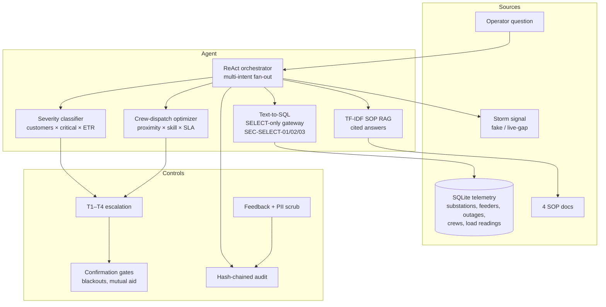

# Architecture

## Data flow

1. `telemetry.build_db()` generates the deterministic SQLite database.
2. The orchestrator decomposes a question into sub-tasks and routes each
   to one tool; the SQL gateway enforces read-only access.
3. Severity classification and dispatch optimization run on live rows.
4. Tiers and confirmation gates decide what needs a human.
5. Every action and every feedback event lands in the hash-chained audit.
